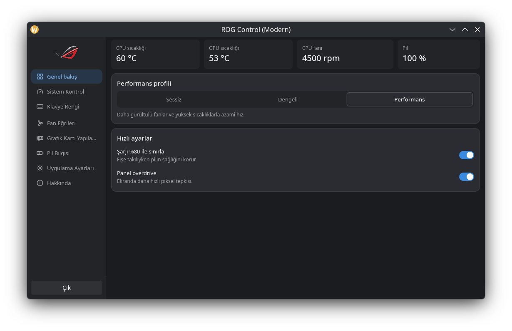
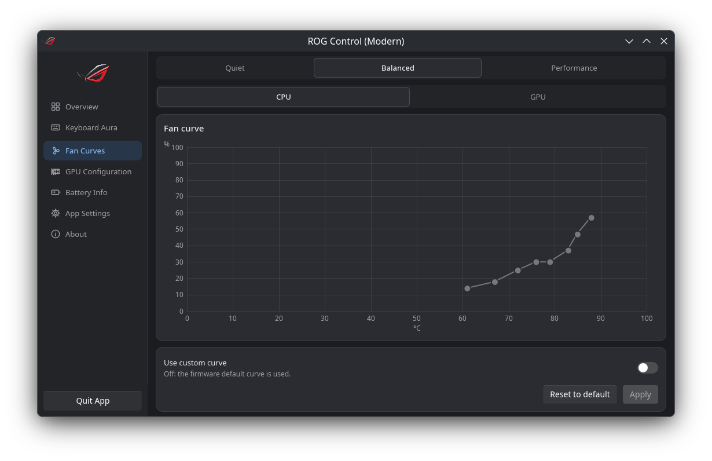
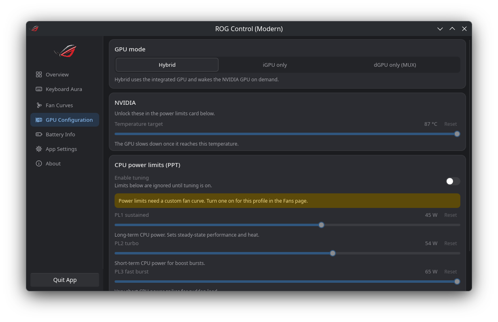
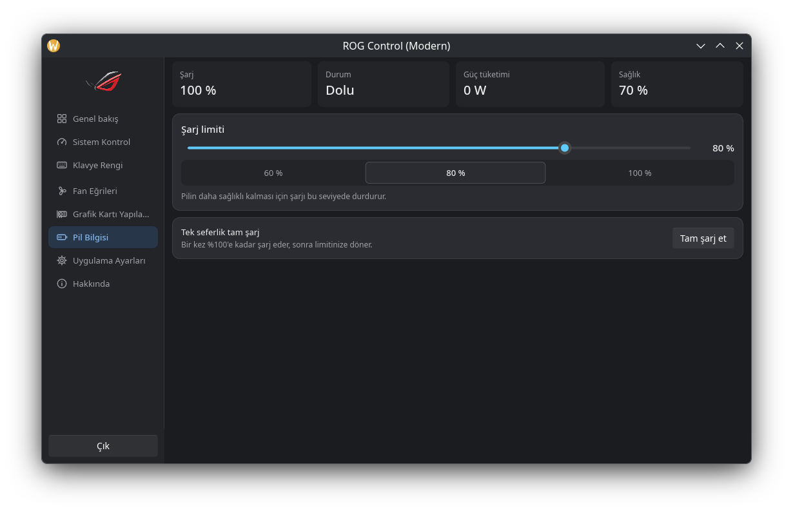
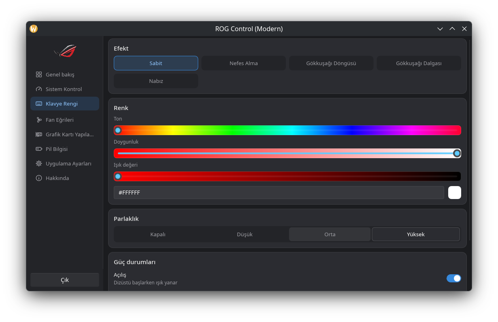

# ROG Control

[](https://github.com/anilsrml/asusctl-modern-ui/releases/latest)
[](LICENSE)
[](https://slint.dev)

A cleaner, simpler control panel for ASUS ROG / TUF laptops on Linux. It is a drop-in companion to [asusctl](https://github.com/OpenGamingCollective/asusctl): same `asusd` daemon, redesigned app.



| Fan curves | GPU |
|---|---|
|  |  |
| **Battery** | **Keyboard lighting** |
|  |  |

Screenshots: ASUS TUF Gaming A15 FA507RM (on battery, so some power limits are lower or hidden).

## English

A modern Slint-based GUI for [asusd](https://github.com/OpenGamingCollective/asusctl) on ASUS ROG / TUF laptops: overview dashboard, performance profiles, fan curves, GPU mode, battery limit, keyboard lighting and more.

- Based on [OpenGamingCollective/asusctl](https://github.com/OpenGamingCollective/asusctl) (MPL-2.0). The daemon is **unchanged** and **required**: install and run `asusd` first.
- Not affiliated with or endorsed by ASUS.

### What's different from upstream ROG Control Center

- One **Overview** page replaces the crowded System Control page: live temperatures, fans and battery, one-click profile, auto profile on AC / battery, quick settings
- Redesigned **Fan curves** (drag points, live value readout, monotonic curve), **GPU**, **Battery** (charge limit presets, health, one-time full charge) and **Keyboard lighting** pages
- One flat light / dark theme, sidebar icons, success / error toasts that show the reason
- Only the features your laptop supports are shown
- Installs per user without sudo and runs side by side with upstream `rog-control-center`
- `--page fans` (or overview, keyboard, gpu, battery, …) opens straight on a page

### Install

Requires `asusd` (from asusctl) to be installed and running. One command, no sudo:

```sh
curl -fsSL https://raw.githubusercontent.com/anilsrml/asusctl-modern-ui/main/packaging/get.sh | bash
```

It downloads the latest release, checks its sha256, installs to `~/.local` and puts a "ROG Control" shortcut on your Desktop and in the app menu. Run the same command again to update. Without the Desktop shortcut: `... | bash -s -- --no-desktop-shortcut`.

Manual install from the [release page](https://github.com/anilsrml/asusctl-modern-ui/releases/latest):

```sh
tar xf asusctl-modern-ui-<version>-x86_64-linux.tar.gz
cd asusctl-modern-ui-<version>-x86_64-linux
./install.sh            # user-local, no sudo
./install.sh --uninstall
```

### Build from source

Needs Rust (see `rust-toolchain.toml`), gettext (`msgfmt`) and the usual Slint/Wayland/X11 dev libraries.

```sh
cargo build --release -p rog-control-center-modern    # target/release/rog-control-center-modern
packaging/make-release.sh                      # tarball in dist/
```

### Coexistence with upstream rog-control-center

This app has its own identity, so both can be installed and run at the same time:

| | upstream | this fork |
|---|---|---|
| binary | `rog-control-center` | `rog-control-center-modern` |
| app id / D-Bus name | `xyz.ljones.rogcc` | `io.github.anilsrml.RogControlModern` |
| config | `~/.config/rog/` | `~/.config/rog-modern/` |
| gettext domain | `rog-control-center` | `rog-control-center-modern` |

Both talk to the same `asusd` (`xyz.ljones.*`). Avoid changing the same setting from both at once.

Translations are looked up in: `$ROGCC_LOCALE_DIR`, `<exe_dir>/../share/locale`, `$XDG_DATA_HOME/locale`, `/usr/share/locale`.

## Türkçe

ASUS ROG / TUF dizüstü bilgisayarlarda [asusd](https://github.com/OpenGamingCollective/asusctl) için Slint tabanlı modern bir arayüz: genel bakış, performans profilleri, fan eğrileri, GPU modu, pil sınırı, klavye aydınlatması ve fazlası.

- [OpenGamingCollective/asusctl](https://github.com/OpenGamingCollective/asusctl) (MPL-2.0) tabanlıdır. Servis (daemon) **değiştirilmemiştir** ve **gereklidir**: önce `asusd` kurulu ve çalışır olmalıdır.
- ASUS ile bağlantılı değildir, ASUS tarafından onaylanmamıştır.

### Kurulum

`asusd` (asusctl) kurulu ve çalışıyor olmalı. Tek komut, sudo gerekmez:

```sh
curl -fsSL https://raw.githubusercontent.com/anilsrml/asusctl-modern-ui/main/packaging/get.sh | bash
```

En son sürümü indirir, sha256 ile doğrular, `~/.local` altına kurar ve masaüstüne "ROG Control" kısayolu ekler. Güncellemek için aynı komutu tekrar çalıştırın.

Elle kurulum:

```sh
tar xf asusctl-modern-ui-<sürüm>-x86_64-linux.tar.gz
cd asusctl-modern-ui-<sürüm>-x86_64-linux
./install.sh            # kullanıcı dizinine, sudo gerekmez
./install.sh --uninstall
```

### Kaynaktan derleme

```sh
cargo build --release -p rog-control-center-modern
packaging/make-release.sh
```

### Upstream ile birlikte kullanım

Uygulamanın kendi kimliği vardır (`rog-control-center-modern`, D-Bus adı `io.github.anilsrml.RogControlModern`, ayarlar `~/.config/rog-modern/`); upstream `rog-control-center` ile aynı anda kurulu olabilir ve çalışabilir. İkisi de aynı `asusd` servisine bağlanır.

## License

MPL-2.0, see [LICENSE](LICENSE) and [NOTICE](NOTICE). Upstream README: [docs/UPSTREAM_README.md](docs/UPSTREAM_README.md).

The user interface is built with [Slint](https://slint.dev), used under the Slint Royalty-free Desktop, Mobile, and Web Applications License (attribution above). "ASUS" and "ROG" are trademarks of ASUSTeK Computer Inc.; this project is not affiliated with ASUS.
